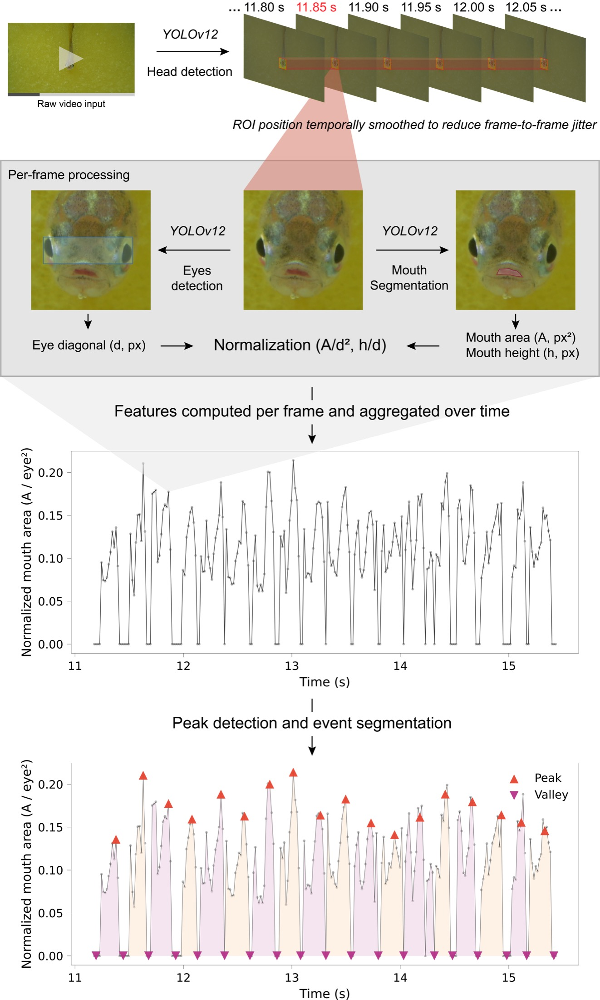
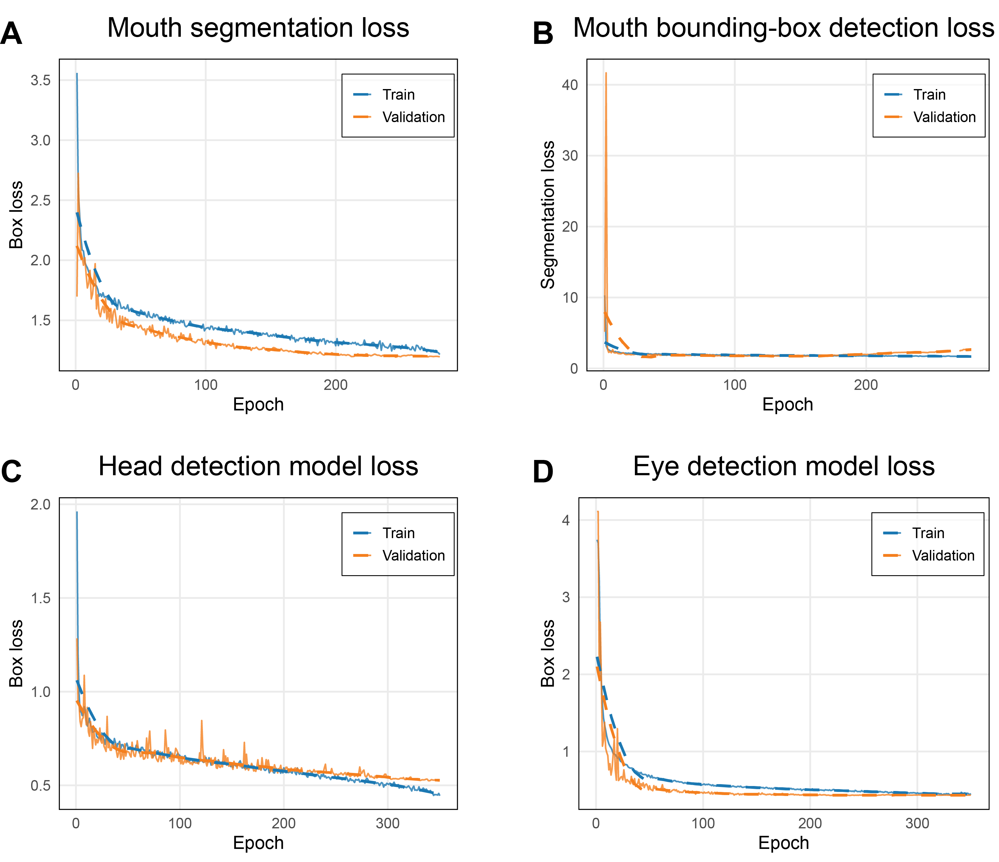
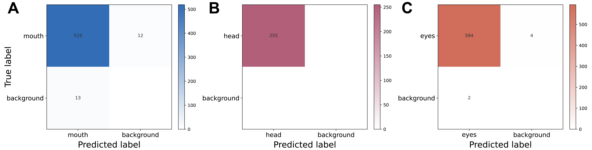

<div align="center">

<a name="zofia"></a>
<h1>ZOFIA — <ins>Z</ins>ebrafish <ins>O</ins>ral-<ins>F</ins>acial <ins>I</ins>nformatics &amp; <ins>A</ins>nalysis</h1>

<p>From zebrafish videos to mouth-opening events.<br>Reusable analysis workflow · Pretrained detection and segmentation models</p>

<a href="#setup"></a>
<a href="https://pytorch.org/"></a>
<a href="https://github.com/sunsmarterjie/yolov12"></a>
<a href="#pretrained-models"></a>
<a href="https://github.com/Tsutayaaa/ZOFIA"></a>

<p>
<a href="#pretrained-models">Model weights</a> ·
<a href="#setup">Setup</a> ·
<a href="#usage">Usage</a> ·
<a href="#model-development-and-validation">Validation</a> ·
<a href="#publications-and-citation">Citation</a> ·
<a href="https://github.com/Tsutayaaa/ZOFIA/issues">Issues</a>
</p>

</div>

---

## Overview

ZOFIA (Zebrafish Oral-Facial Informatics & Analysis) is a video-analysis pipeline for detecting and quantifying mouth-opening events in adult zebrafish. It combines fish-head detection, mouth segmentation and eye-based size normalization to turn recordings into frame-level measurements and event-level summaries.

The workflow supports quantitative studies of oral behaviour by extracting opening counts, event durations and mouth-opening measurements. Cropped videos, signal plots and optional annotated previews allow users to inspect the detections alongside the numerical results.

This repository focuses on the reusable video-analysis workflow and pretrained head, eye and mouth model weights. The checkpoints can be used independently or together in the ZOFIA pipeline. Study-specific downstream statistical analyses are outside the current open-source release.

## Features

| Capability | What you get |
| --- | --- |
| Head tracking | Smoothed, head-centred video crops |
| Mouth and eye models | Mouth masks, eye-region boxes and frame-level measurements |
| Size normalization | Relative mouth area A/d² and opening height h/d |
| Event extraction | Complete opening–closing cycles and event statistics |
| Batch processing | Single-video or recursive directory input |
| Reviewable outputs | CSV, JSON, signal plots and optional annotated previews |

## Architecture

<p align="center">
  <a href="docs/images/workflow-preview.jpg"></a>
</p>

*Workflow: video → smoothed head crop → eye detection and mouth segmentation → normalized signals → opening–closing events. Click any figure to view a larger version.*

The implementation uses the diagonal of the detected eye-region bounding box as its size reference, rather than a distance calculated from two eye-centre landmarks.

## Workflow

1. **Preprocess the recording.** Detect the head, smooth the crop position and resize the cropped frames to 640 × 640 pixels.
2. **Extract frame-level features.** Measure mouth-mask area, mouth-mask height and eye-box diagonal.
3. **Normalize the signal.** Divide mouth area by the squared eye-box diagonal, and mouth height by the diagonal.
4. **Identify opening events.** Find peaks and valleys, clean consecutive extrema of the same type and retain complete valley–peak–valley cycles.
5. **Export results.** Save measurements, event statistics and visualizations for review and downstream analysis.

Event detection uses normalized area; the event JSON reports raw area and height statistics together with the eye-box diagonal at the detected peak. These are image-based measurements, rather than calibrated physical dimensions.

## Pretrained models

**[Browse model weights](model/)** · **[Model release v1.0.0](https://github.com/Tsutayaaa/ZOFIA/releases/tag/models-v1.0.0)** · **[Try standalone inference](#standalone-inference)**

> [!NOTE]
> Download the five checkpoints from [models-v1.0.0](https://github.com/Tsutayaaa/ZOFIA/releases/tag/models-v1.0.0), or use the copies in [`model/`](model/). The links below download individual release assets.

| Checkpoint | Task | Architecture recorded in checkpoint | Size |
| --- | --- | --- | ---: |
| [`head_detect_v2.pt`](https://github.com/Tsutayaaa/ZOFIA/releases/download/models-v1.0.0/head_detect_v2.pt) | Head detection | YOLOv12n | 5.20 MiB |
| [`head_detect.pt`](https://github.com/Tsutayaaa/ZOFIA/releases/download/models-v1.0.0/head_detect.pt) | Head detection (earlier checkpoint) | YOLO11n | 5.19 MiB |
| [`fisheyes2.0.pt`](https://github.com/Tsutayaaa/ZOFIA/releases/download/models-v1.0.0/fisheyes2.0.pt) | Eye-region detection | YOLOv12 | 5.23 MiB |
| [`fishmouth_R3.1.pt`](https://github.com/Tsutayaaa/ZOFIA/releases/download/models-v1.0.0/fishmouth_R3.1.pt) | Mouth-opening segmentation | YOLO12 segmentation | 5.87 MiB |
| [`fishmouth_R4.0.pt`](https://github.com/Tsutayaaa/ZOFIA/releases/download/models-v1.0.0/fishmouth_R4.0.pt) | Mouth-opening segmentation (alternative checkpoint) | YOLO12 segmentation | 5.89 MiB |

These checkpoints can also be used independently of the ZOFIA event-analysis pipeline. Head detection operates on the recording; the eye and mouth models are used on head-centred crops. Match this preprocessing when applying them to new recordings.

<details>
<summary><strong>Checkpoint compatibility and label notes</strong></summary>

Four checkpoints record Ultralytics version `8.3.63`; the earlier `head_detect.pt` records `8.3.82`. Use an installation that supports the recorded model architecture; this metadata does not guarantee compatibility with every Ultralytics or YOLOv12 distribution. No inference or cross-version accuracy benchmark has been rerun for this release.

**Eye-model labels:** `fisheyes2.0.pt` records two class labels, `1` and `fish_eyes`. Inspect the predicted classes before using its bounding boxes for normalization. `fisheyes3.0.pt` is excluded from the release because its metadata identifies a mouth-segmentation model (`fish_mouth`); its intended identity still needs confirmation.

</details>

### Standalone inference

After downloading `fishmouth_R3.1.pt`, run inference on a head-cropped image or video in a compatible environment:

```python
from ultralytics import YOLO

model = YOLO("fishmouth_R3.1.pt")
results = model.predict(source="head_cropped.mp4", conf=0.3, save=True)
```

For head detection, load `head_detect_v2.pt` and use the original recording as input. Mouth predictions contain segmentation masks; head and eye detection predictions contain bounding boxes. These calls perform model inference only; event counting and normalization require the ZOFIA pipeline.

<details>
<summary><strong>Download verification and model license metadata</strong></summary>

The release includes [SHA256SUMS](https://github.com/Tsutayaaa/ZOFIA/releases/download/models-v1.0.0/SHA256SUMS) and [model_manifest.json](https://github.com/Tsutayaaa/ZOFIA/releases/download/models-v1.0.0/model_manifest.json) for file verification. To verify downloaded checkpoints, place the five `.pt` files and `SHA256SUMS` together and run:

```bash
# macOS
shasum -a 256 -c SHA256SUMS
# Linux
sha256sum -c SHA256SUMS
```

Checkpoint metadata includes an Ultralytics AGPL-3.0 license reference. See the upstream license information embedded in the files when reusing or redistributing the models.

</details>

## Setup

Clone the repository:

```bash
git clone https://github.com/Tsutayaaa/ZOFIA.git
cd ZOFIA
```

The core analysis uses Python, PyTorch, Ultralytics YOLO, OpenCV, NumPy, pandas, SciPy, Matplotlib and tqdm. Model checkpoints are included in [`model/`](model/).

### Current environment notes

The repository contains research scripts with environment-specific configuration. Before running:

- Configure the analysis modules so they can be imported as `fishmouth_behavior`. Both pipeline scripts use this package name, while the modules in this checkout are stored under `src/`; the current checkout does not include a package installer that resolves this mapping.
- Use a model-compatible installation of `ultralytics`, which is imported by the source code but is not listed in `requirements.txt`.
- Review [`requirements.txt`](requirements.txt) against your platform and install the packages required by your chosen workflow. The dependency list may need additional directly imported analysis packages.
- The Slurm scripts contain local cluster paths and settings. In particular, `run_pipeline.sh` refers to `pipeline2.py`, which is not present in this repository. Use the Python entry points below after configuring the environment.

## Usage

Run commands from the repository root after resolving the environment and package-import setup above.

### Analyse a single video

The direct pipeline processes the recording at its original duration:

```bash
python pipeline.py \
    --input_file /path/to/video.mp4 \
    --output_dir ./results \
    --head_model ./model/head_detect_v2.pt \
    --eye_model ./model/fisheyes2.0.pt \
    --mouth_model ./model/fishmouth_R3.1.pt \
    --create_preview
```

The model paths shown above refer to checkpoints included in the repository. The eye detector records two classes, so check that the selected eye box corresponds to the intended eye region before quantitative analysis. Select checkpoints appropriate for your recordings; the filenames alone do not establish which combination performs best.

Omit `--create_preview` to skip annotated-video rendering.

### Analyse a directory

Replace `--input_file` with `--input_dir`:

```bash
python pipeline.py \
    --input_dir /path/to/videos \
    --output_dir ./results \
    --head_model ./model/head_detect_v2.pt \
    --eye_model ./model/fisheyes2.0.pt \
    --mouth_model ./model/fishmouth_R3.1.pt
```

Directory input searches subdirectories for `.mp4`, `.avi`, `.mov` and `.mkv` files, case-insensitively. Use distinct video basenames within a batch, because output directories are named after each video's stem.

Detection confidence and event-detection thresholds are configured in the `config` dictionary in `pipeline.py`. The direct pipeline uses peak prominence 0.01, minimum peak height 0.01 and a minimum peak distance of 10 samples. The distance is measured in frames, so its time equivalent depends on the recording frame rate.

### Five-minute analysis

[`pipeline_for_5min.py`](pipeline_for_5min.py) provides a separate workflow with the same input, output and model-path arguments. It analyses the full five-minute interval, five one-minute intervals and six ten-second intervals within the first minute.

> [!IMPORTANT]
> This script writes a 300-second recording by truncating longer inputs and looping shorter inputs. Use recordings of the intended duration for temporal comparisons, or use `pipeline.py` to preserve the original recording duration.

## Outputs

For the direct pipeline, each video receives its own results directory:

| Location | Contents |
| --- | --- |
| `01_preprocessed/` | Head-cropped video |
| `02_detection_data/` | Frame-level detection CSV |
| `03_analysis_results/` | Event JSON |
| `04_visualizations/` | Analysis plot and optional annotated preview |
| `<video_name>_summary.txt` | Event count and results location |
| `batch_summary.json` in the output root | Processing configuration and reports for successfully processed videos |

Detection CSVs contain `frame_number`, `timestamp_sec`, `mouth_area`, `mouth_height` and `eye_box_diagonal`.

Event records include start and end frames, duration, area and height statistics, their peak frames and the eye-box diagonal at the detected area-signal peak. The five-minute workflow also exports a segment-level CSV summary.

## Model development and validation

The core pipeline combines YOLOv12-based head and eye bounding-box detectors with a mouth-segmentation model. The head detector first generates head-centred images for subsequent eye and mouth annotation. The manuscript also includes training curves for a separate mouth bounding-box detector; this additional model is not required by the segmentation-based pipeline or listed among the release checkpoints.

The models build on [YOLOv12](https://github.com/sunsmarterjie/yolov12) by Tian, Ye and Doermann (2025); see the [YOLOv12 reference](#yolov12-reference). The checkpoint table above distinguishes the earlier YOLO11 head detector from the YOLOv12-based models.

| Annotation target | Annotated images | Annotation type |
| --- | ---: | --- |
| Head | 237 | Bounding box |
| Eye region | 5,826 | One bounding box enclosing both eyes |
| Mouth opening | 2,674 | Polygonal segmentation of the visible buccal cavity |

Annotations were prepared in Label Studio under standardized guidelines and reviewed by senior annotators. Each dataset was split into training, validation and test sets at a 70/20/10 ratio; model training used NVIDIA RTX 4090 GPUs on the XJTLU HPC cluster.

### Training dynamics

<p align="center">
  <a href="docs/images/loss.png"></a>
</p>

*Training dynamics: (A) mouth segmentation, (B) mouth bounding-box detection, (C) head detection and (D) eye detection.*

<details>
<summary>How to read the training curves</summary>

Losses fall rapidly early in training and then decrease more gradually or plateau. Training and validation curves broadly follow similar trends, although panel B shows a late validation-loss increase and panel C retains a train–validation gap. The curves support convergence; generalization is assessed separately on held-out data.

</details>

### Detection agreement with human annotations

<p align="center">
  <a href="docs/images/heatmap.png"></a>
</p>

*Validation confusion matrices: (A) mouth, (B) head and (C) eyes. Rows are true labels and columns are predicted labels. Diagonal target counts indicate matched detections; target-to-background entries are false negatives and background-to-target entries are false positives.*

The following counts are transcribed from the figure. Precision and recall are calculated from those displayed counts, using precision = TP/(TP + FP) and recall = TP/(TP + FN).

| Model | True positives | False positives | False negatives | Precision | Recall |
| --- | ---: | ---: | ---: | ---: | ---: |
| Mouth | 519 | 13 | 12 | 97.56% | 97.74% |
| Head | 255 | — | — | — | — |
| Eyes | 594 | 2 | 4 | 99.66% | 99.33% |

<details>
<summary>Metric definitions and evaluation limits</summary>

The head panel labels 255 matched detections but leaves the other cells blank; additional values are not inferred here. Background–background cells are also blank, so frame-level accuracy and specificity are not calculated. These matrices summarize detection agreement, while pixel-level segmentation quality requires separate mask metrics such as IoU or Dice. The supplied figure does not specify confidence or matching-IoU thresholds, or map each panel to a particular released checkpoint.

</details>

### End-to-end event counting

The manuscript reports a comparison of automated and manually counted events across **ten 60-second videos**, including untreated and pharmacologically treated fish:

| Event-count comparison | Reported result |
| --- | ---: |
| Spearman correlation | ρ = 1.000 |
| Mean difference, AI minus human | +0.90 events per 60 s |
| Bland–Altman 95% limits of agreement | −13.75 to +15.55 events per 60 s |

These results describe the manuscript's evaluation dataset and are not a benchmark independently reproduced from this checkout. The manuscript also reports a mean inter-annotator segmentation IoU of 0.69; this measures agreement between human annotations, rather than model segmentation accuracy.

## Project structure

| Path | Purpose |
| --- | --- |
| [`pipeline.py`](pipeline.py) | Direct analysis of single videos or batches |
| [`pipeline_for_5min.py`](pipeline_for_5min.py) | Five-minute analysis across multiple time windows |
| [`src/preprocess/`](src/preprocess/) | Head cropping and video-splitting utilities |
| [`src/mouth_detect/`](src/mouth_detect/) | Mouth segmentation and eye detection |
| [`src/analysis/`](src/analysis/) | Normalization and event analysis |
| [`src/visualization/`](src/visualization/) | Signal plots and preview utilities |
| [`src/config/`](src/config/) | Configuration-loading utility |
| [`model/`](model/) | Head, eye and mouth model checkpoints |
| [`run_pipeline.sh`](run_pipeline.sh), [`run_5min.sh`](run_5min.sh) | Environment-specific Slurm job scripts |
| [`make_csv.py`](make_csv.py) | Auxiliary event-count aggregation script |

## Analysis considerations

Detection quality depends on recording conditions, head orientation and the visibility of the mouth and eye region. Inspect cropped recordings, signal plots and previews when applying the models to a new dataset.

Missing mouth detections are stored as zero measurements. Missing or zero eye diagonals are forward-filled and then backward-filled for normalization; if no usable eye measurements exist, the normalized signals are set to zero. Detection failures can therefore affect event counts and should be checked visually.

The event detector retains complete cycles bounded by valleys. Partial events at recording or segment boundaries may be excluded, and counts from independently analysed segments need not sum to the count from the full recording.

## Publications and citation

### ZOFIA manuscript

A full research manuscript describing ZOFIA and its application to adult zebrafish oral movements is not yet formally published. The model-development and validation information above is drawn from that manuscript. Until a journal citation is available, please use the following conference references when referring to the project.

### Conference references

- He, S., et al. (2025a). *Modeling Oral Motor Phenotypes in Zebrafish Using AI Tools.* Joint Research Symposium of XJTLU–Taylor’s–MFU, Suzhou, China.
- He, S., et al. (2025b). *Modeling oral dyskinesias in zebrafish, and its AI-powered detection and quantification.* International Conference of Physiological Sciences, Hangzhou, China.

### Related review

ZOFIA is also discussed in the review below, which cites the conference work. This is a related review, rather than the primary ZOFIA methods paper.

Eroshkin, A.A., et al. (2026). Swimming in the future already: the use of AI in zebrafish neurobehavioral research and CNS drug screening. *Neuroscience*, **611**, 354–366. [https://doi.org/10.1016/j.neuroscience.2026.07.014](https://doi.org/10.1016/j.neuroscience.2026.07.014)

### YOLOv12 reference

Tian, Y., Ye, Q. and Doermann, D. (2025). *YOLOv12: Attention-Centric Real-Time Object Detectors.* Advances in Neural Information Processing Systems, 38. [Paper](https://arxiv.org/abs/2502.12524) · [Source code](https://github.com/sunsmarterjie/yolov12).

Please cite the YOLOv12 paper when using the underlying architecture, alongside the ZOFIA work when using this workflow or its zebrafish-specific weights.

<p align="right"><a href="#zofia">Back to top ↑</a></p>
